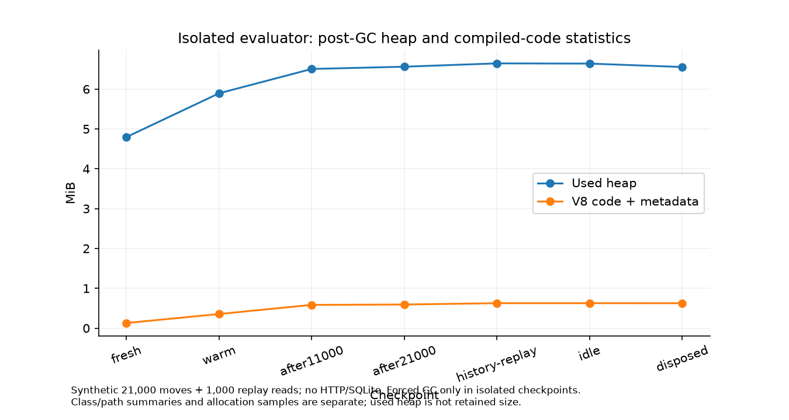

# Heap retention investigation — ZGE12

**COMPILED_CODE + GC_OR_HEAP_CAPACITY supported in the isolated evaluator; whole-service growth remains INCONCLUSIVE. No leak-free claim.** One synthetic authorized builder executes21000 candidate moves and1000 replay reads. No HTTP/SQLite is involved in this probe. Forced GC, allocation sampling and snapshots run only in a separate diagnostic process, outside the real request loop. Raw heap payloads are private, aggregated in another process and deleted; observer tables are not retained inside the measured runtime. Small GC/sample metadata remains explicitly diagnostic.

| Checkpoint | Used heap MiB | Code + metadata KiB |
|---|---|---|
| fresh | 4.797 | 132.64 |
| warm | 5.895 | 363.95 |
| after11000 | 6.506 | 598.69 |
| after21000 | 6.562 | 607.87 |
| history-replay | 6.645 | 642.50 |
| idle | 6.640 | 642.50 |
| disposed | 6.554 | 641.87 |

WorldEvaluator, MultiplayerConstructionRuntime and GameplayEventJournal remain exactly one each while active and all disappear after disposal. WeakRef clears and the finalization callback reports WorldEvaluator. Strong root paths explicitly show GC roots→stack/context→evaluator→#runtime→#journal. These are shortest strong paths with weak edges excluded, **not dominator retained sizes**. The active runtime owns its journal as expected; no growing owner chain was observed. Last10000 moves add only57.86KiB post-GC heap in this probe.

Allocation samples retain function/call stacks, including canonical JSON, immutable snapshot/candidate evaluation and serialization paths. They identify allocation volume at sampled sites, not which allocations remain live. `allocation-summary.json` and class/path summaries provide exact quantities. Code/metadata growth and stable runtime classes support compilation/reuse; increased used heap alone does not prove a leak.

Editor24-switch/backend diagnostics alternate model-bearing100-entity projects and empty worlds. All disposed engine weak references clear at each checkpoint. Empty scenes retain2 listeners,0asset leases/pending work,0model registries,5renderer geometries and103observed DOM listeners. Used heap grows by about0.68/0.70MiB from switch4→24, with compilation/browser caches unresolved. Class name Scene includes both SDK and Three instances; counts cannot be assigned to SDK alone. GPU driver residency is unobservable. This is bounded resource ownership, not indefinite leak freedom.

Classifications: EXPECTED_CACHE—parsed assets while a project is open and recorded durable history; GC_OR_HEAP_CAPACITY—active-service sawtooth/capacity telemetry; COMPILED_CODE—direct V8 code/metadata and heap category evidence; RETAINED_RUNTIME_OBJECTS—one active evaluator/runtime/journal, disappearing after disposal; CONFIRMED_LEAK—none demonstrated; INCONCLUSIVE—whole-service positive trends, remaining editor growth, unobserved GPU residency and broader construction/mission retaining paths. The long HTTP workload separately includes construction/claims/history, but its retaining paths are not equated with this fixed-state move probe.

