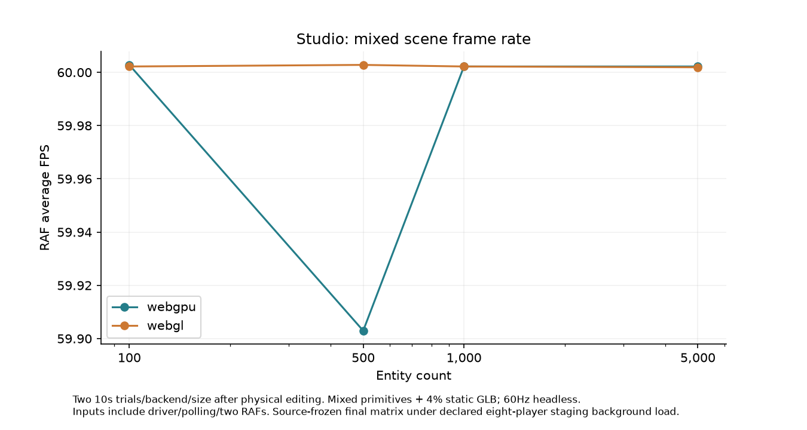
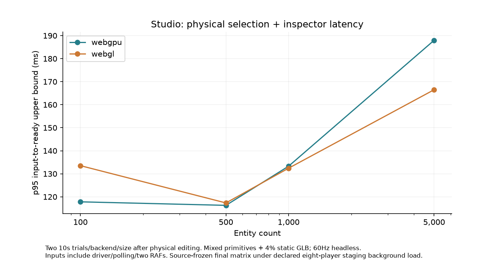
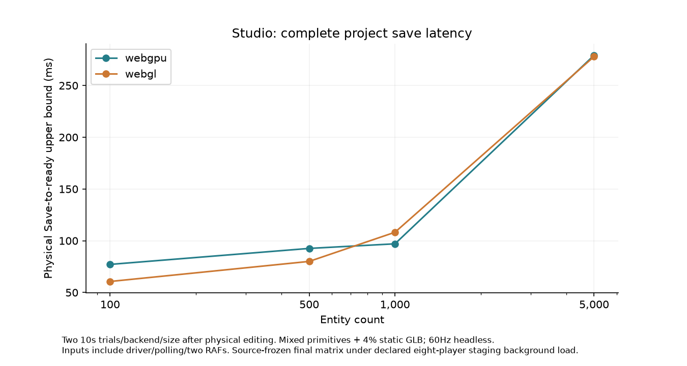
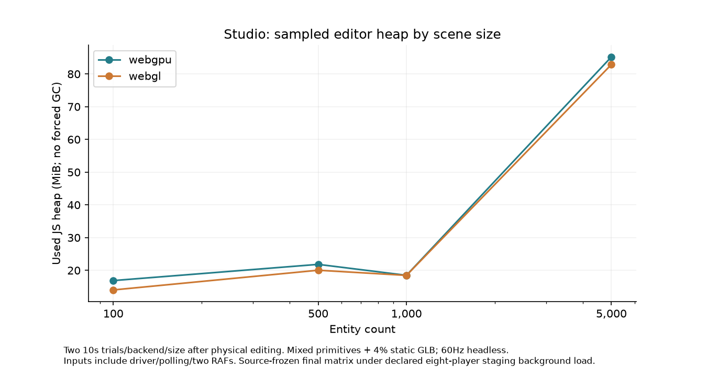

# Large-scene editor benchmarks — ZGE12

The deterministic public-API fixture generator preserves100,500,1000 and5000 entity sizes. Each includes transforms, state and editor components, three primitive types/colors and4% self-authored static GLB references. Default camera placement shows actual dense geometry at5000; no scene size was silently reduced. This is a synthetic authoring workload, not a complex game with full physics, skeletons, textures or AI.

Chrome155, M1Pro16GPU/10CPU cores,16GiB, macOS26.5.2;1440×1000, DPR1, headless near60Hz. Both real WebGPU and forced WebGL execute. Each condition uses two10-second foreground RAF trials after physical editing and1.5s warmup. Timing measures driver input through resulting state plus two RAFs; it includes polling/actionability and is not isolated handler time. Public fixture creation/validation time is distinct from browser import time. The first exploratory matrix overlapped short heap/build work and small editor refinements; final source-frozen rerun and custody are identified by the evidence manifest. Do not compare unrelated workload captures as causal renderer speedups.

| Entities | Backend | FPS / 1% low | Frame p95/p99 ms | Selection p95 ms | Save / export ms | Heap MiB | Import ms |
|---|---|---|---|---|---|---|---|
| 100 | webgl | 60.00 / 59.52 | 16.70/16.80 | 133.53 | 60.63/58.82 | 14.02 | 98.04 |
| 100 | webgpu | 60.00 / 59.52 | 16.80/16.80 | 117.82 | 77.14/45.56 | 16.88 | 93.54 |
| 500 | webgl | 60.00 / 59.52 | 16.80/16.80 | 117.34 | 80.04/53.70 | 20.04 | 123.87 |
| 500 | webgpu | 59.90 / 51.15 | 16.70/16.80 | 116.29 | 92.59/54.25 | 21.83 | 111.68 |
| 1000 | webgl | 60.00 / 59.52 | 16.70/16.80 | 132.43 | 108.19/60.15 | 18.47 | 177.15 |
| 1000 | webgpu | 60.00 / 59.52 | 16.80/16.80 | 133.30 | 97.03/55.52 | 18.49 | 149.68 |
| 5000 | webgl | 60.00 / 59.52 | 16.70/16.80 | 166.50 | 277.99/102.62 | 82.88 | 512.60 |
| 5000 | webgpu | 60.00 / 59.52 | 16.70/16.80 | 187.97 | 279.26/110.98 | 85.22 | 507.42 |

Every condition physically selects/inspects five entities, applies a two-entity local offset, checks one-step undo/redo, cancels a real gizmo drag when a hit-tested handle exists, saves, exports and reloads. Raw frame intervals, interaction durations, long-task samples, CDP TaskDuration deltas, heap/object/resource observations, screenshots and exported projects are retained. Exported fixture data—not a hidden server writer—is the authoring source. GPU utilization and resident VRAM are not measured.

Profiling supported a UI improvement: original hierarchy rebuilding scanned all entities for children repeatedly and built a full DOM; the inspector also created one parent select option per entity. The indexed/virtualized hierarchy renders a fixed visible window at≥200 entities. Large parent-reference controls accept an exact validated ID instead of allocating thousands of options. Inspector/resource/dirty refresh work is cached by actual change. Viewport rendering remains separate.

A matched preliminary primitive-only before/after condition at5000 went from25196 to255 DOM elements, selection1091.30→103.34ms and save1023.50→237.32ms. One trial; browser actionability/scroll behavior and later UI refinements limit causal precision. The frame captures exclude interaction stalls; selection/save/long-task data disclose them separately. Scene parsing/history still copies bounded snapshots; history100 can consume significant memory. No instancing or spatial index was added without renderer bottleneck evidence.5000 passes this documented synthetic boundary; no general world/population cap,120Hz guarantee or production limit is inferred.

