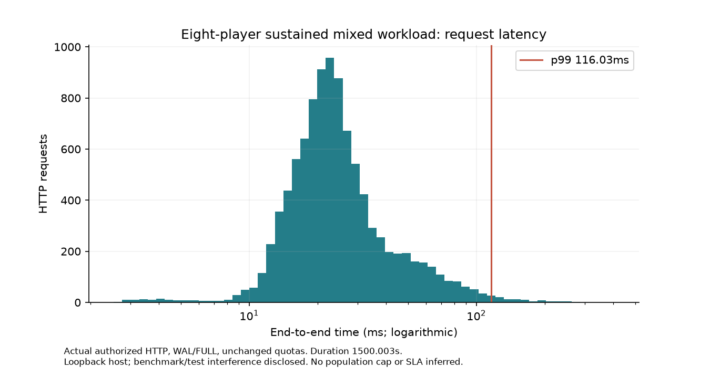
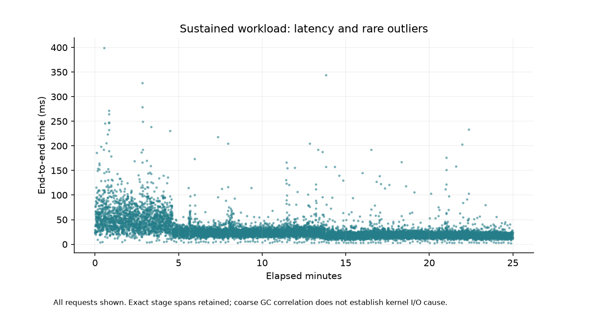
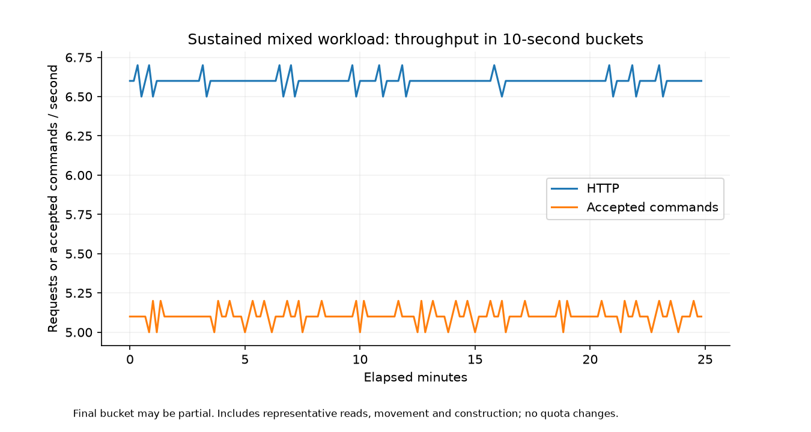

# Long-run staging operations — ZGE12

A fresh private managed service runs eight authorized actors and eight PHP gateways against one persistent world worker for1500.003s. The mixed workload includes movement, construction, read/history and progression/claim paths with explicit synthetic100000-stone starting supplies. It retains normal240/principal/min,600/IP/min quotas and admission backpressure. No live legacy writer, production identity or durability policy changes.

```
{
  "durationMs": 1500002.516125,
  "requests": {
    "total": 9900,
    "httpAccepted": 9900,
    "acceptedCommands": 7661,
    "duplicateReceipts": 0,
    "throttled": 0,
    "rejectedCommands": 303,
    "transportFailures": 0,
    "classes": {
      "read": 1800,
      "construction": 900,
      "movement": 7064,
      "reconnect": 136
    },
    "reasons": {
      "occupied": 300,
      "stale-world-revision": 3
    }
  },
  "requestsPerSecond": 6.59998892906857,
  "acceptedCommandsPerSecond": 5.107324766221648,
  "latencyMs": {
    "count": 9900,
    "p50": 23.024124999996275,
    "p95": 68.4657920000027,
    "p99": 116.0289590000175,
    "max": 399.55658300000505
  },
  "stagesMs": {
    "payload": {
      "count": 9764,
      "p50": 0.022166,
      "p95": 0.054458,
      "p99": 0.198167,
      "max": 13.927
    },
    "databaseOpen": {
      "count": 9764,
      "p50": 0.717958,
      "p95": 2.597708,
      "p99": 6.829917,
      "max": 299.431542
    },
    "quota": {
      "count": 9764,
      "p50": 0.354167,
      "p95": 1.216875,
      "p99": 3.40975,
      "max": 34.5905
    },
    "authentication": {
      "count": 9764,
      "p50": 0.272709,
      "p95": 0.673334,
      "p99": 2.062668,
      "max": 22.114334
    },
    "authorization": {
      "count": 9764,
      "p50": 0.006542,
      "p95": 0.01675,
      "p99": 0.043459,
      "max": 3.7045
    },
    "runtimeEnsure": {
      "count": 9764,
      "p50": 0.390083,
      "p95": 3.463708,
      "p99": 7.654958,
      "max": 64.687791
    },
    "admission": {
      "count": 9764,
      "p50": 0.830333,
      "p95": 3.095083,
      "p99": 8.806208,
      "max": 217.001458
    },
    "lockWait": {
      "count": 9764,
      "p50": 0.012083,
      "p95": 0.044084,
      "p99": 0.128792,
      "max": 5.699583
    },
    "validation": {
      "count": 9764,
      "p50": 2.501583,
      "p95": 5.898042,
      "p99": 13.986666,
      "max": 122.743416
    },
    "ipc": {
      "count": 9764,
      "p50": 10.267417,
      "p95": 37.695625,
      "p99": 63.725084,
      "max": 202.979584
    },
    "candidateValidation": {
      "count": 9764,
      "p50": 0.04925,
      "p95": 0.10125,
      "p99": 0.190916,
      "max": 7.886042
    },
    "transactionWrites": {
      "count": 9764,
      "p50": 0.551416,
      "p95": 1.492458,
      "p99": 3.757917,
      "max": 38.5545
    },
    "commitValidation": {
      "count": 9764,
      "p50": 0.010458,
      "p95": 0.024292,
      "p99": 0.044583,
      "max": 3.252417
    },
    "commit": {
      "count": 9764,
      "p50": 0.373792,
      "p95": 1.059792,
      "p99": 3.112417,
      "max": 44.357416
    },
    "eventRead": {
      "count": 9764,
      "p50": 0.440167,
      "p95": 0.984583,
      "p99": 2.198,
      "max": 58.980042
    },
    "receiptConstruction": {
      "count": 9764,
      "p50": 0.322458,
      "p95": 0.821417,
      "p99": 1.704667,
      "max": 15.34325
    },
    "responseSerialization": {
      "count": 9764,
      "p50": 0.220958,
      "p95": 0.514542,
      "p99": 1.166666,
      "max": 8.086959
    }
  },
  "transactionMs": {
    "count": 9764,
    "p50": 13.515958,
    "p95": 42.9185,
    "p99": 70.407125,
    "max": 213.814834
  },
  "runtimeEvaluationMs": {
    "count": 9764,
    "p50": 5.423708000103943,
    "p95": 13.270791999995708,
    "p99": 21.911917000019457,
    "max": 122.8841670000038
  },
  "runtimeQueueMs": {
    "count": 9764,
    "p50": 0.003499999991618097,
    "p95": 0.00833400001283735,
    "p99": 0.016500000027008355,
    "max": 1.461542000004556
  },
  "faults": [],
  "final": {
    "revision": 7669,
    "cursor": 24817,
    "archiveReceipts": 7972,
    "personalClaims": 4,
    "teamClaims": 1,
    "personalXp": [
      {
        "id": "load-0",
        "xp": 0,
        "rank": "ensign"
      },
      {
        "id": "load-1",
        "xp": 1064,
        "rank": "ensign"
      },
      {
        "id": "load-2",
        "xp": 0,
        "rank": "ensign"
      },
      {
        "id": "load-3",
        "xp": 1050,
        "rank": "ensign"
      },
      {
        "id": "load-4",
        "xp": 0,
        "rank": "ensign"
      },
      {
        "id": "load-5",
        "xp": 1022,
        "rank": "ensign"
      },
      {
        "id": "load-6",
        "xp": 0,
        "rank": "ensign"
      },
      {
        "id": "load-7",
        "xp": 1050,
        "rank": "ensign"
      }
    ],
    "stone": 98804,
    "acceptedPlaces": 299,
    "deterministicReplay": true
  }
}
```

All trace records, sampled CPU/RSS/heap/GC/FD/database size, worker lifecycle and full archive audit are retained. One acknowledged command is counted only when actual output reports success. Gameplay rejections differ from transport/auth/admission failures. Unexpected failures remain in the counts; none are silently excluded. Source archive replay must match full snapshot, receipts and claims before the overall bound is called PASS.

The first part overlaps complete-engine/legacy tests, browser regressions, clean packaging and plotting; unrelated host apps are not stopped. Later intervals are quieter. This is a real loopback staged workload, not an isolated maximum-capacity or kernel storage benchmark. Tail analysis retains stage spans/GC windows; positive heap trend is classified rather than called a leak. No whole-service forced GC is added. Historical runs have different duration/content and cannot establish a causal percentage improvement.

The outermost foreground monitor's death still requires manual restart. Engine tests repeat worker/gateway/launcher crash, database failure, lost reply, auth and recovery invariants on independent disposable fixtures. This long run does not simulate power loss or establish a production SLA, remote failover, player cap or indefinite leak freedom.





Final read-only audit:7,972 commands/24,817 events; full snapshot, every receipt/event and4personal/1team claims match exactly (56.068s audit). Owned CPU averaged16.37% of one core; numeric FDs224→224 (peak231), one worker start and zero restarts/timeouts/auth failures. Sampled used-heap tail after the first20%:+0.093MiB/min, INCONCLUSIVE for retained-size growth. No service forced GC, quota or durability change.
