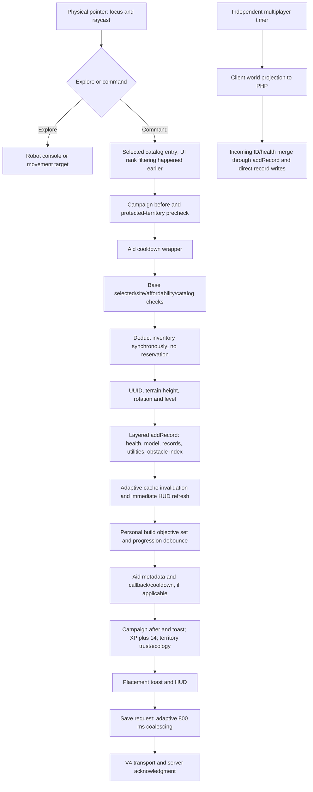

# Source runtime reconstruction — ZGE-05

The executable replacement is `ConstructionRuntime`, composed from the existing Construction v2, core immutable world schema/event journal, and mission reducer. The independent scene owns ENGINE authority. It neither imports nor mutates the legacy bundle. Live construction remains LEGACY (optional SHADOW observation only).

## Actual legacy order

Evidence: unchanged `assets/index-02987539.js`; exact marker positions/digest in `evidence/zge05/source-facts.json`; readable extracted segments 03, 04, 06, 07; `AdaptiveSimulationDirector.js:354`; executable `legacy-effects.test.mjs`; physical-pointer browser evidence. Reconstructed segments are derived artifacts, not recovered original TypeScript or a reproducible original build.

There is **no explicit resource reservation**, transaction ID, writer lease, accepted-command journal or atomic boundary in the legacy placement path. There is no canonical gameplay-event bus for these effects: callbacks, direct writes, DOM changes and timers carry them. Rank filtering is UI policy, not a base-place authorization check. The source-owned runtime deliberately uses a stronger transaction contract; that is not proof of whole-game equivalence.

| Boundary | Input → output / owner | State, dependencies, errors and recovery |
|---|---|---|
| Input/selection | Pointer + selected type → world point; legacy UI/game | Camera/raycaster/terrain meshes; explore branches do not construct. Shared protected territory blocks non-aid before place. Selection alone spends nothing. |
| Validation | Type/site/resources/terrain → null or continue; legacy manager | `isValidSite` writes utilityTerrain/lastConnectionRequirement; utility requirements and water/bridge/habitat rules vary. Denial formatting performs further queries. No structured authoritative rejection code. |
| Deduction/identity | Effective catalog cost → decremented resource object, random UUID/rotation | Lieutenant mineral discount; no reservation/undo. Retry can spend again, with another ID. Bridge rotation/height are terrain-derived. |
| Record publication | Record → model/group/records/health/spatial utilities | Optimized wrapper sets mutation hint; health wrapper normalizes health and water height; original utility wrapper adjusts bridge height, calls base model insertion, updates utility graph; terrain index and adaptive invalidation/HUD follow. Exceptions can leave partial effects. |
| Progression/achievements | New record → personal `build-type` set | localStorage and missionStats; rank HUD; debounced 220 ms progression request and periodic synchronization. Set suppresses repeated personal achievement, not base spending or XP. |
| Aid | Project record → metadata/cooldown/effect callback | Callback follows record/progression. This artifact captures `zkApplyAidProject` from an absent earlier implementation: only three identifier occurrences (capture, wrapper assignment, call). Executing that wrapper without external replacement throws after cooldown mutation. This is a pre-existing source finding, not a newly introduced failure or certified aid effect parity. |
| Pointer completion | Placed record → campaign comparison, XP +14, territory trust −12/ecology −4, HUD/toasts/save | Presentation exceptions are not isolated in this handler. Campaign before/after is evaluated; mission unlock UI is not a durable reward transaction. |
| Persistence | Deferred request → v4 envelope → acknowledged transport | Raw request is not durable completion. Retry, conflict, pending recovery and XP extension remain ZGE-02 owned. Ordinary-page save/ID restoration is browser tested. Boss QA isolation remains intentional. |
| Replication | Periodic client snapshot → PHP response → local merge | Independent of save acknowledgment. New IDs call addRecord; newer health timestamps directly overwrite health; cooldown/relations merge separately. No evidence of server-side construction cost/occupancy arbitration. |

## Other writers that prevent a complete seam

Relocation continuously changes record x/z (and mesh) while dragging, periodically refreshes utility indexes, and commits or snaps back. The survey temporarily splices a record from records, restoring it in finally. Relocation permits loss of utility for most types and only refreshes HUD at finish; there is no explicit save in `zkRelocateFinish` (later autosave/network may observe it). Repair spends half-cost, writes full health/timestamp/sabotage state, rebuilds utilities, emits pulse/toast, updates HUD and saves. Enemy damage directly changes health/integrity, visual scale/opacity and utilities, with deferred save. Restore batches addRecord; multiplayer independently adds and changes health. No general construction remove API was located in the investigated artifact; destroyed structures remain records at zero health. Reset/restore can replace a record collection. The independent engine supports explicit removal with no refund.

`legacy-effects.test.mjs` executes actual extracted code for pointer order, protected territory, rejection, personal-objective persistence, relocation, model failure, presentation failure and the unresolved aid callback. Browser manager parity additionally exercises all 26 definitions, real terrain, health/model/utility wrappers and raw collisions. These tests do not certify absent aid effects, every mission, all health/utility graph details or PHP distributed authority.

## Replacement ownership

The new runtime prepares a detached Construction candidate, derives mission progress/reward application, player/selection changes and ordered records, validates the full plain world, and publishes one immutable state before read-only subscribers run. World revision covers every accepted world command; Construction keeps its separate construction/inventory revisions. Rejections add audit events/receipts but do not advance gameplay revision. Duplicate logical IDs return the prior receipt without new events. Changed payloads reject. Snapshot authority metadata grants no execution permission.

## ZGE-07 update

The independent runtime now has a concrete private ConstructionPort boundary and source-only local/server entry points, with immutable shadow, strict single-mode flags and aid/repair/relocation quarantine. The entire known live effect graph is classified in CONSTRUCTION_COVERAGE_ZGE_07.md; LIVE_AUTHORITY_READINESS_ZGE_07.md keeps live transfer NO-GO.
