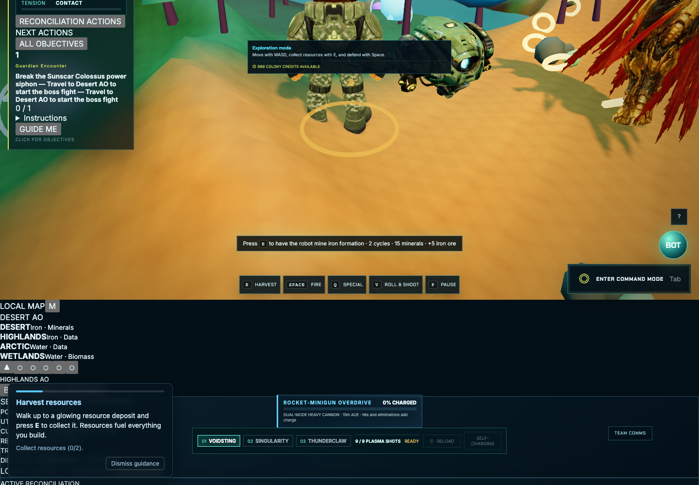

# Boss battle certification

**PASS_WITH_LIMITS for Mission1's Sunscar gate and victory; PARTIAL for the complete12-boss campaign.** Each isolated browser account starts with four standing prerequisite Solar Grids, all five survey visits, supplies and a disclosed initial position. A real build-menu selection and physical terrain click constructs the final fifth grid. No boss health, damage, defeat, reward or encounter-start method is directly invoked by the harness. Read-only wrappers delegate unchanged and record actual placement/hit/start results.

| Final-grid biome | FullbossHP | Physicalencounterduration | Playerdeaths | ClaimedrewardIDs | Claimsafterreload |
|---|---:|---:|---:|---:|---:|
| desert | 818 | 49.818s | 2 | 1 | 1 |
| highlands | 818 | 44.935s | 3 | 1 | 1 |

Both starts were exactly one successful `startEncounter({missionId:'grid',automatic:true,canonicalArena:true})` call. In-biome completion stages in Desert. Highlands completion passes through automatic canonical-arena routing and spawns in Desert, not Highlands. Actual boss position, moving flag, phases, projectiles, player damage attribution and real weapon health changes were recorded. Death/recovery occurred during both fights, so this is not a god-mode damage fixture.

Each physical placement created one new stable ID and charged exactly24minerals/8iron/8biomass/12credits. Physical weapon keys, Space,Q and roll controls defeated the full818HP boss; rewards were100credits/25timber/15iron with one claim ID. Full-page reload retained five grids, defeat and exactly one claim, and moved campaign flow beyond Mission1. XP could increase during later live reload sampling; snapshots are not asserted to be taken at identical simulation time.

No double-start/reward was observed in these cases. A deliberate second replay/shared victory injection is not a natural interaction and was not used to claim broader boss-reward integration coverage. Twelve-mission integration tests are additional logic evidence; natural full-campaign play and late-mission final-objective/reward continuity remain unverified.

The build workflow scrolls the game shell and clips this active screenshot; the visual defect is separately recorded. Health/state/physical-input evidence supports the encounter result without pretending this is an ideal visual boss capture. [Full raw cases](evidence/original/original-boss-fixtures.json).

## Frame observations

Four15-second physical boss trials pooled3582RAF intervals: 59.67averageFPS. Per-case trial averages: Desert59.60/59.47, Highlands59.67/59.94. The clipped viewport/layout and staged prerequisites limit visual/gameplay interpretation; these are actual boss intervals, not Studio proxy values.
