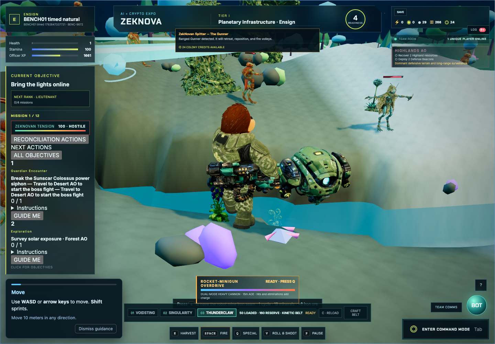

# Original ZekNova gameplay certification

**Verdict: PARTIAL for the full requested campaign scope; the observed core loop works.** This is automated physical browser play in isolated local demo accounts, not a human playtest. Source-engine and Studio results do not satisfy these original-game gates.

The 902.836s loop used real WASD, E, Space, weapon keys, Q, Escape, mode/camera controls and the Save button. Its 54 movement windows all changed world coordinates. Endpoint chords include knockback/death recovery and are not walking-path distance. Player visits recorded Highlands and Desert; Forest/Arctic/Wetlands exploration is not certified by this natural loop.

| Gate | Result and evidence |
|---|---|
| Enlist/Play, terrain, player, lighting, HUD, usable world | PASS on actual WebGPU. Screenshots and six cold/warm reload trials; gameplay-ready is separate from asset settlement and cover removal. |
| WASD forward/backward/strafe | PASS observed displacement; dry collision fixture additionally walked 7.816m before stopping. Focus/menu recovery worked in observed windows. |
| Camera/zoom | PARTIAL: early physical command-mode workflows succeeded; later incident modal intercepted pointer actions. Build-button interaction also scrolls the world shell, clipping the canvas. |
| Collision/grounding | PASS bounded fixture against an actually placed Solar Grid: 10.0m initial distance, 2.201m closest/final clearance, zero sampled walk-surface error. Initial invalid test was paused/out of bounds and is retained, not counted. Slopes/obstruction/map boundaries need broader coverage. |
| Natural exploration | PARTIAL: two of five biomes; loaded models/trees/rocks visible. No whole-map streaming certificate. |
| Construction | PASS_WITH_LIMITS physical fifth-grid placement in two boss prerequisite fixtures, exact 24 minerals/8 iron/8 biomass/12 credits deduction, new ID and persistent model. Naturally earned construction attempt was blocked by an unanswered incident; this does not certify a natural resource-to-first-building tutorial. |
| Placement negatives | PASS observed no new record for occupied terrain, water and insufficient funds; triple-click creates exactly one record; mode cancellation clears selection; shared-water protected terrain denies placement. |
| Combat | PASS bounded ordinary attacks/health changes/XP, kills, harvest, death/recovery. Timed end: 1,309XP, 36kills, 14trees and five rocks. Attribution includes companion/environment effects; fixture observer records real player weapon hits separately. |
| Missions | PARTIAL: Mission1 prerequisites/final objective, automatic boss, victory, unlock and reload exercised in two seeded fixtures. Missions2–12 are not individually browser-certified. Existing campaign integration tests remain additional logic evidence. |
| Boss | PASS_WITH_LIMITS Sunscar two routing cases; no direct damage/finish calls or health edits. Four standing grids, surveys, supplies and initial position seeded. |
| XP/rank | XP earned and persisted. Ensign remained Ensign; no natural rank promotion is certified. |
| Save/recovery | PASS_WITH_LIMITS acknowledgment, outage/retry, real409, browser restart, real401/reload and outbox recovery. Retry operation IDs change after lost ACK; see persistence report. |
| First15minutes / uninterrupted long play | PARTIAL: a 902.836s capture exists, but a later diplomatic incident was not answered by the initial harness. Keyboard gameplay continued under its blur; 21pointer actions timed out. Last successful pointer workflow at525.707s is a separate timing window. |

The modal itself presents valid choices; the harness's failure to choose is not a product soft lock. Continuing gameplay input underneath a blocking modal is an independently reproducible input-gating concern. See [defects](DEFECT_REGISTER.md), [bosses](BOSS_BATTLE_CERTIFICATION.md), [physics/combat/missions](PHYSICS_COMBAT_MISSIONS.md) and [analysis](ORIGINAL_GAMEPLAY_ANALYSIS.md).

