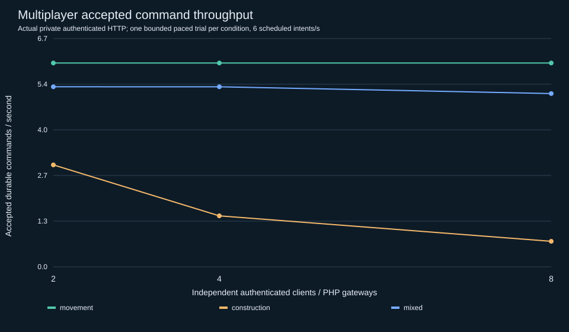
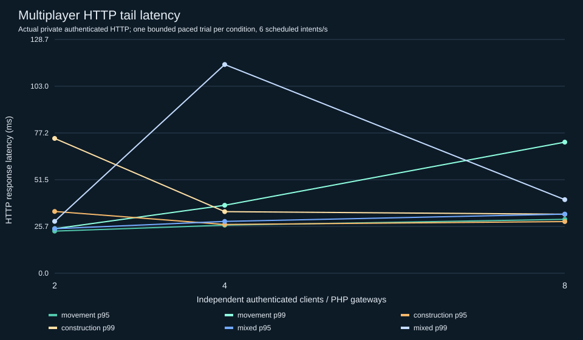

# Source-owned multiplayer load results — ZGE-BENCH-01

**Outcome: PASS_WITH_LIMITS for bounded local staging correctness; maximum-player and long-run capacity not established.** The source-owned construction world is independently playable through physical controls for two, four and eight authenticated browser contexts. All 36 private HTTP workload archives replayed exactly, including command receipts, event bytes/checksums, complete final snapshots and personal/team claims. This report does not certify the original legacy ZekNova game's multiplayer or combat.

The machine-readable [analysis](evidence/multiplayer/analysis/summary.json) contains every profile/client count, stage percentile, observed recovery time, per-request slow trace, process/memory sample and exact audit. The 56-test security/recovery run and 2/4/8 physical browser results are in [source persistence and recovery](SOURCE_ENGINE_PERSISTENCE_RECOVERY.md).

## Conditions and method

Loopback HTTP against fresh private SQLite databases; PHP gateway count equals2/4/8 authenticated actors and a single fenced world worker. Managed outer service, supervised persistent Node runtime, Unix socket IPC, unchanged bearer authentication, normal principal240/min and shared world-IP600/min quotas, normal admission limits and SQLite durable transaction settings remain active. All non-movement HTTP fixtures explicitly start with100000 synthetic shared stone for workload longevity; movement starts with12. Neither seed changes runtime behavior or authentication/quotas.

Sustained profiles are paced at6 scheduled intents/s per world (not per player); mixed construction refreshes state before issuing an original placement/removal intent, so measured HTTP/s can exceed6. Bursts issue48 original scheduled intents across independent actors without pacing, plus required mixed reads or recovery retries. Accepted command throughput excludes reads, rejected gameplay and duplicate receipts. Each condition has one trial. Short profiles are bounded workload observations and cannot establish a supported population, statistically robust tail latency or an Internet service SLA.

The workload's monotonic end-to-end HTTP timer includes fetch plus JSON parsing/reconciliation, not browser frame delivery. Percentiles sort finite timings and select index floor((N-1)*p). Handler stages are observational and can overlap; their sum is not a request total. Queue metrics are worker/admission measurements; external socket/PHP queue time is unavailable. Five-second process samples include the harness, owned service/launcher/worker and PHP gateways; helper-process CPU between samples can be missed. Brief sampler subprocesses can cause perturbation; maximum sampler duration is retained. No GPU utilization is claimed for this HTTP benchmark.

Runtime/toolchain and HEAD use the root benchmark environment manifest. Fixture/runtime/test source hashes are in [source custody](evidence/multiplayer/source-custody.json). No authority source, quota policy, golden hash, gameplay behavior, existing service or production database was modified.

## Sustained profiles

|Profile|Clients / gateways|HTTP/s|Durable accepted/s|p50 ms|p95 ms|p99 ms|429|Transport/fault failures|Gameplay rejections|
|---|---:|---:|---:|---:|---:|---:|---:|---:|---:|
|construction|2 / 2|6.00|3.00|20.59|34.00|74.21|0|0|60|
|history|2 / 2|6.00|0.00|4.43|10.68|63.42|0|0|0|
|mixed|2 / 2|6.60|5.30|16.00|24.50|28.55|0|0|0|
|movement|2 / 2|6.00|6.00|16.50|23.19|24.52|0|0|0|
|read|2 / 2|6.00|0.00|7.15|10.93|11.95|0|0|0|
|recovery|2 / 2|6.00|5.97|18.04|26.38|79.26|0|1|0|
|construction|4 / 4|6.00|1.50|19.42|26.84|33.90|0|0|90|
|history|4 / 4|6.00|0.00|3.98|6.59|8.34|0|0|0|
|mixed|4 / 4|6.60|5.30|17.41|28.52|114.91|0|0|0|
|movement|4 / 4|6.00|6.00|18.39|26.45|37.41|0|0|0|
|read|4 / 4|6.00|0.00|7.98|12.88|21.60|0|0|0|
|recovery|4 / 4|6.00|5.97|18.13|26.22|133.21|0|1|0|
|construction|8 / 8|6.00|0.75|18.98|28.44|32.48|0|0|105|
|history|8 / 8|6.00|0.00|4.90|9.70|16.11|0|0|0|
|mixed|8 / 8|6.60|5.10|19.06|32.53|40.50|0|0|4|
|movement|8 / 8|6.00|6.00|20.64|29.66|72.16|0|0|0|
|read|8 / 8|6.00|0.00|9.19|15.93|19.88|0|0|0|
|recovery|8 / 8|6.00|5.97|20.34|54.89|160.39|0|1|0|

Construction rejections and stale world revisions reflect authoritative conflict handling; exact reasons/counts are retained in JSON. Recovery-profile503/transport failures are injected-fault outcomes; they are counted, never discarded from latency or relabeled as accepted gameplay. Quota/admission429 responses remain visible and preserve original intent IDs for retries.

## Burst profiles

|Profile|Clients / gateways|HTTP/s|Durable accepted/s|p50 ms|p95 ms|p99 ms|429|Transport/fault failures|Gameplay rejections|
|---|---:|---:|---:|---:|---:|---:|---:|---:|---:|
|construction|2 / 2|76.22|38.11|23.58|43.84|46.07|0|0|24|
|history|2 / 2|747.11|0.00|2.14|4.25|4.66|0|0|0|
|mixed|2 / 2|113.03|56.51|13.97|33.03|39.33|0|0|6|
|movement|2 / 2|98.92|98.92|19.10|29.40|30.86|0|0|0|
|read|2 / 2|373.59|0.00|4.69|7.24|10.20|0|0|0|
|recovery|2 / 2|86.52|43.26|13.62|25.96|29.61|0|25|0|
|construction|4 / 4|83.42|20.86|47.35|68.51|69.39|0|0|36|
|history|4 / 4|1073.86|0.00|2.77|6.11|10.01|0|0|0|
|mixed|4 / 4|101.06|53.90|22.82|78.12|79.38|0|0|4|
|movement|4 / 4|82.66|82.66|46.89|60.64|63.70|0|0|0|
|read|4 / 4|593.80|0.00|5.52|10.14|11.72|0|0|0|
|recovery|4 / 4|85.68|42.84|22.29|50.16|182.98|0|25|0|
|construction|8 / 8|70.56|8.82|108.33|138.19|142.12|0|0|42|
|history|8 / 8|1193.25|0.00|2.82|11.62|15.38|0|0|0|
|mixed|8 / 8|89.55|44.78|48.19|211.45|364.92|0|0|6|
|movement|8 / 8|67.58|67.58|110.62|148.84|150.09|0|0|0|
|read|8 / 8|479.33|0.00|15.41|16.80|24.90|0|0|0|
|recovery|8 / 8|66.15|42.72|105.86|272.87|307.12|0|17|0|

The burst figures are short peak observations under unchanged quotas. They must not be described as realistic sustained gameplay or extrapolated into a maximum supported player count. State/history have zero accepted mutation commands by definition.

## Stage attribution: eight-player mixed paced profile

|Stage|p50 ms|p95 ms|p99 ms|max ms|
|---|---:|---:|---:|---:|
|authentication|0.25|0.41|0.51|0.89|
|authorization|0.01|0.02|0.07|0.16|
|quota|0.38|0.78|1.62|17.10|
|admission|0.87|1.78|7.35|22.50|
|lockWait|0.01|0.03|0.04|0.11|
|databaseOpen|0.67|1.71|2.25|6.23|
|ipc|9.26|15.90|20.48|112.50|
|commit|0.37|0.63|0.86|4.23|

For this mixed run, transaction p95=19.23ms, runtime evaluation p95=10.45ms and runtime queue p95=0.01ms. Across all fresh workloads, largest observed database-open=305.94ms and COMMIT=15.47ms. These measurements do not identify the host/storage root cause of historical slow opens/commits. Per-request top slow records and all raw stages remain available for attribution.

## Recovery while traffic continues

|Profile|Clients|Fault|Observed first successful higher-generation response ms|
|---|---:|---|---:|
|burst-recovery-2|2|worker-SIGKILL-burst|333.40|
|burst-recovery-4|4|worker-SIGKILL-burst|277.36|
|burst-recovery-8|8|worker-SIGKILL-burst|292.35|
|recovery-2clients-36s|2|worker-SIGKILL|291.83|
|recovery-4clients-36s|4|worker-SIGKILL|309.98|
|recovery-8clients-36s|8|worker-SIGKILL|326.34|

Recovery duration starts at fault dispatch and ends at completion of the first observed successful higher-generation HTTP response; it includes the scheduler/polling interval. Burst recovery retries original pending IDs after the owned worker is ready. No authority transfer or multi-writer bypass occurs. Every associated complete archive audit passed.

## Memory, process and descriptor observations

|Profile|Clients|Duration s|Worker heap start/end/peak MiB|Aggregate RSS start/end/peak MiB|FD start/end/peak|Sampled CPU % of one core|
|---|---:|---:|---|---|---|---:|
|construction|2|20.00|6.88 / 9.63 / 19.22|320.75 / 333.88 / 333.88|92 / 92 / 96|13.65|
|history|2|20.17|6.89 / 6.89 / 6.89|324.61 / 264.25 / 324.61|92 / 92 / 93|3.97|
|mixed|2|20.00|6.90 / 10.19 / 13.29|331.89 / 319.61 / 335.95|92 / 92 / 97|12.55|
|movement|2|20.00|6.90 / 12.71 / 12.71|329.39 / 295.78 / 329.39|92 / 92 / 92|11.55|
|read|2|20.00|6.90 / 6.95 / 6.95|321.95 / 281.44 / 321.95|92 / 92 / 92|5.80|
|recovery|2|36.00|6.91 / 12.50 / 20.75|328.28 / 296.08 / 328.28|92 / 92 / 98|8.72|
|construction|4|20.00|6.16 / 14.89 / 14.89|469.88 / 416.59 / 469.88|136 / 136 / 136|13.05|
|history|4|20.00|6.15 / 6.15 / 6.15|430.11 / 365.98 / 430.13|136 / 136 / 136|4.00|
|mixed|4|20.00|6.18 / 21.04 / 21.04|466.47 / 442.45 / 468.72|136 / 136 / 136|13.35|
|movement|4|20.00|6.18 / 12.75 / 13.54|476.69 / 406.91 / 476.69|136 / 136 / 136|12.75|
|read|4|20.00|6.18 / 7.87 / 7.87|488.16 / 379.31 / 488.16|136 / 136 / 136|6.55|
|recovery|4|36.00|6.11 / 11.70 / 21.89|477.53 / 401.06 / 477.53|136 / 136 / 136|11.44|
|construction|8|20.00|7.49 / 14.71 / 14.71|720.39 / 631.09 / 729.58|224 / 224 / 224|13.55|
|history|8|20.00|7.49 / 7.49 / 7.49|772.52 / 569.08 / 772.52|224 / 224 / 224|5.10|
|mixed|8|20.00|7.13 / 15.82 / 15.82|695.91 / 656.69 / 695.91|224 / 224 / 224|14.45|
|movement|8|20.17|7.49 / 16.30 / 16.30|710.94 / 626.67 / 710.94|224 / 224 / 224|14.68|
|read|8|20.00|7.11 / 9.68 / 9.68|694.48 / 603.98 / 694.48|224 / 224 / 224|8.00|
|recovery|8|36.17|7.14 / 11.82 / 20.37|694.48 / 644.13 / 694.48|224 / 224 / 229|13.49|

These short unforced-GC samples do not prove leak freedom or a retained-object leak. Recovery swaps worker generations, so its heap slope does not describe one process. Earlier ZGE-11 code-space/heap-growth attribution and dominator-level retention questions remain unresolved. The old20-minute evidence remains historical; this milestone did not repeat an equivalent long multiplayer soak.

## Historical comparison

|Milestone|Condition|Duration|HTTP requests|p50/p95/p99 ms|Classification|
|---|---|---:|---:|---|---|
|ZGE-10|8 actors, mixed,6 scheduled intents/s|900s|5940|17.75 /31.84 /79.96|Historical recorded baseline|
|ZGE-11|8 actors, mixed,6 scheduled intents/s|1200.17s|7921|19.78 /38.15 /121.42|Historical recorded baseline|
|ZGE-BENCH-01|8 actors, mixed,6 scheduled intents/s|20.00s|132|19.06 /32.53 /40.50|NONCOMPARABLE for improvement/regression: shorter duration, current host load/cache state, one trial|

Same authority/HTTP harness lineage and hardware family make the measurements useful context. Different durations/archive sizes and no paired-control run prevent a causal percentage-improvement/regression claim. Historical maximum488.63ms COMMIT and402.89ms database-open spikes remain unresolved even if absent from short current profiles. No unchanged/improved label is awarded solely because current samples are faster.

## Actual-data charts





## Reproduction

From the repository root, while other performance suites are stopped:

```sh
env ZGE_EVIDENCE_DIR=/tmp/zge-bench01-repro-load ZGE_DURATION_SECONDS=20 ZGE_RECOVERY_SECONDS=36 \
 node scripts/zge-bench01-multiplayer-run.mjs
env ZGE_EVIDENCE_DIR=/tmp/zge-bench01-repro-load ZGE_ANALYSIS_DIR=/tmp/zge-bench01-repro-analysis \
 node scripts/zge-bench01-multiplayer-analyze.mjs
```

Each workload closes only its owned private fixture before running the existing read-only full archive audit. The audit CLI separately refuses live runtime sockets, symlinked/public directories and non-private fixture paths. Credential/session files are not copied into published evidence. Failed harness attempts, if any, are retained separately and do not become PASS data.

For browser functional reproduction, set PLAYWRIGHT_MODULE to the installed Playwright module and run scripts/zge-bench01-multiplayer-browser.mjs. It creates all private users itself; no credentials are supplied or printed. It uses real keyboard down/up, focus and construction-button clicks. The first browser attempt lacked a convergence wait between players' placements; authority correctly rejected stale state and the harness timed out. The corrected test waits for reconciliation; source behavior and assertions remain unchanged.

Production is NO-GO pending the existing security/identity/TLS/operations/live-authority gates. The source engine's local staging verdict must remain separate from original gameplay and Studio/SDK verdicts.
